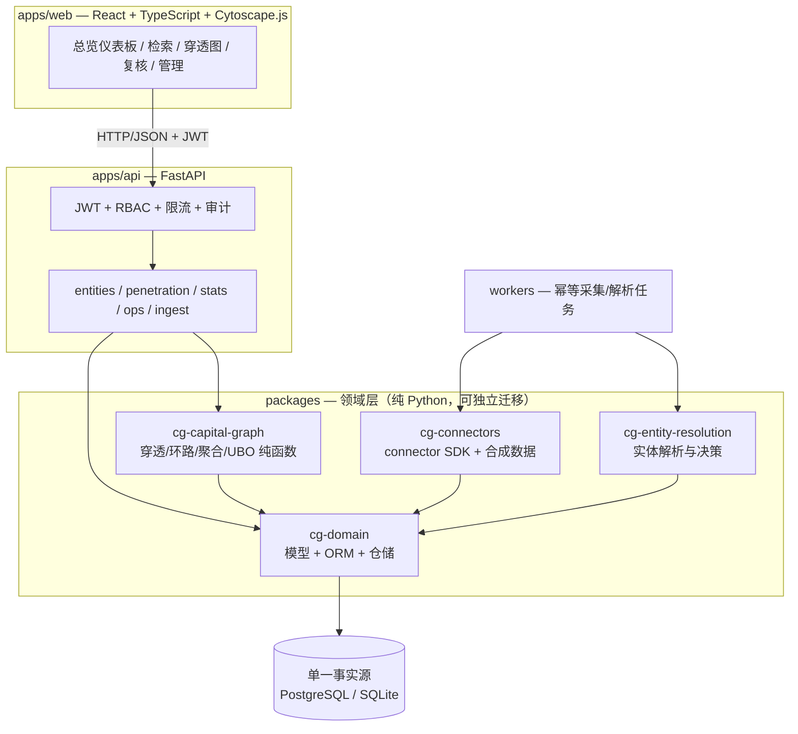
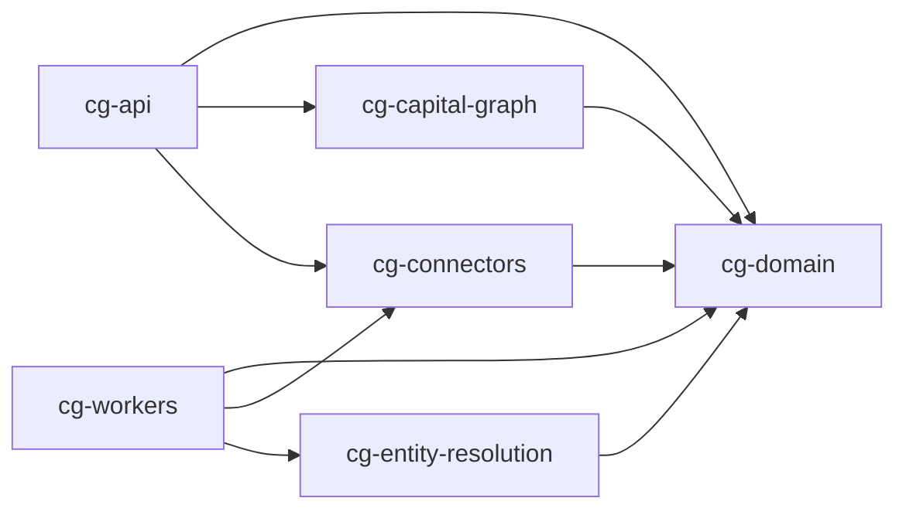

# CapitalGraph CN 架构

版本：0.2 ｜ 2026-09-11

## 总体形态

模块化单体 API + 独立 worker 进程 + SPA 前端，单一关系型事实源。



## 模块依赖图（由 `scripts/module_graph.py` 从实际导入生成，CI 强制校验）



```text
┌────────────┐   HTTP/JSON   ┌─────────────────┐   SQLAlchemy   ┌──────────────┐
│ apps/web   │ ────────────▶ │ apps/api        │ ─────────────▶ │ PostgreSQL   │
│ React+TS   │               │ FastAPI         │                │ (生产)        │
│ Cytoscape  │               │ RBAC/审计/限流   │                │ SQLite(本地) │
└────────────┘               └───────┬─────────┘                └──────▲───────┘
                                     │ 进程内调用包                      │
                            ┌────────▼─────────────────────────────────┴────────┐
                            │ packages/domain      领域模型 + ORM + 迁移源        │
                            │ packages/capital_graph  穿透/环路/聚合/UBO(纯函数) │
                            │ packages/entity_resolution 实体解析与决策记录      │
                            │ packages/connectors  connector SDK + 合成数据      │
                            └────────▲──────────────────────────────────────────┘
                                     │
                             ┌───────┴────────┐
                             │ workers        │ 采集/重算 任务(幂等,退避)
                             └────────────────┘
```

## 模块职责

| 模块 | 职责 | 关键约束 |
| --- | --- | --- |
| cg-domain | 实体/标识符/别名/证券/声明/证据/解析决策/派生结果 的类型与 ORM | 原始层只追加；每条声明带证据与状态 |
| cg-capital-graph | 向上/向下穿透、环路、交叉持股、有效权益聚合、UBO 候选 | 纯函数确定性；深度/比例/节点/超时上限；unknown 不编造 |
| cg-entity-resolution | 规范化、USCC 校验、名称相似度、候选评分、阈值决策 | 禁止仅凭名称合并；记录决策与版本 |
| cg-connectors | Connector 协议、运行器、速率限制、幂等键、对象存储、合成/CSV 数据源 | 遵守 robots/条款；失败隔离；可停用 |
| apps/api | 检索/详情/穿透/时间点/证据/复核/管理 REST + OpenAPI | 默认拒绝 RBAC、限流、审计、输入输出 schema |
| workers | 采集任务执行、重试、快照落库 | 幂等键防重；失败原因可追溯 |
| apps/web | 检索、详情、图浏览（展开/收起/筛选/时间点/路径高亮）、表格、导出 | 空态/错误态/权限态；超大图降级 |

## 请求链路（示例：穿透查询）

1. `web` 携带 JWT 调 `GET /api/v1/entities/{id}/penetration/up?at=2020-06-30&min_ratio=0.01`
2. `api` 鉴权 → 限流 → 参数校验（Pydantic）→ 审计记录
3. 从声明表按 `at` 时点加载有效声明（`valid_from<=at<valid_to`，status=active）
4. `capital_graph` 执行配置化遍历（深度≤N、min_ratio、路径上限、节点上限、超时）
5. 返回路径乘积、聚合有效权益、控制依据、环路/交叉持股标记、证据引用、算法假设与配置哈希

## 数据分层

- **原始层（append-only）**：`source_documents`、`source_snapshots`、`ingestion_runs`、`evidence_fragments`。
  网页消失不删除历史；原文持久化可关闭（哈希+链接始终保留）。
- **标准化层（版本化修正）**：实体、标识符、别名、声明（`status`: active/superseded/retracted/disputed）。
- **发布层（可重算）**：`derived_paths`、`ownership_calculations`、`risk_flags`，记录输入版本/算法版本/配置哈希。

## 事实等级（claim basis）

`raw`（原始事实）→ `normalized`（标准化事实）→ `inferred`（算法推断）→ `manual`（人工判断）。
每条声明与派生结果必须标注等级；UBO 输出一律为 `candidate`。

## 时间点语义

查询 `at=T` 时：取 `valid_from <= T < valid_to` 且当时 `status=active` 的声明。
当前状态不覆盖历史；`recorded_at` 与 `valid_from` 分离，可回答"某一日期公开记录显示什么"。
