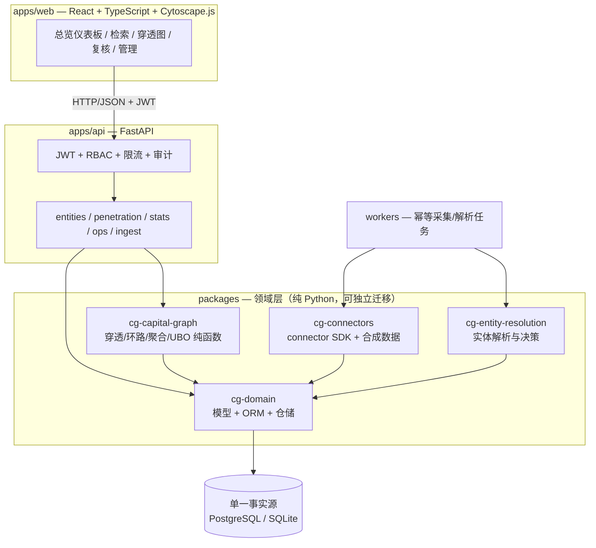
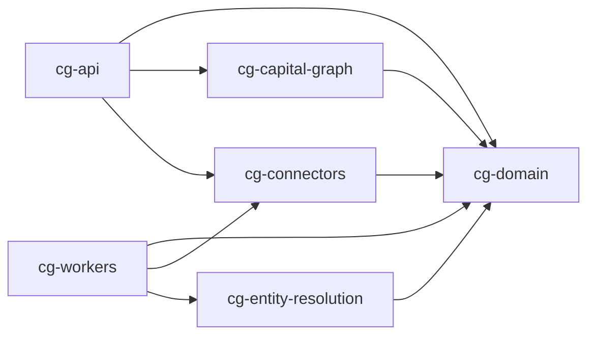

# CapitalGraph CN 架构

版本：0.3 ｜ 2026-09-12

## 总体形态

模块化单体 API + 独立 worker 进程 + SPA 前端，单一关系型事实源。



## 模块依赖图（由 `scripts/module_graph.py` 从实际导入生成，CI 强制校验）



```text
┌────────────┐   HTTP/JSON   ┌─────────────────┐   SQLAlchemy   ┌──────────────┐
│ apps/web   │ ────────────▶ │ apps/api        │ ─────────────▶ │ PostgreSQL   │
│ React+TS   │               │ FastAPI         │                │ (生产)        │
│ Cytoscape  │               │ RBAC/审计/限流   │                │ SQLite(本地) │
└────────────┘               └───────┬─────────┘                └──────▲───────┘
                                     │ 进程内调用包                      │
                            ┌────────▼─────────────────────────────────┴────────┐
                            │ packages/domain      领域模型 + ORM + 迁移源        │
                            │ packages/capital_graph  穿透/环路/聚合/UBO(纯函数) │
                            │ packages/entity_resolution 实体解析与决策记录      │
                            │ packages/connectors  connector SDK + 合成数据      │
                            └────────▲──────────────────────────────────────────┘
                                     │
                             ┌───────┴────────┐
                             │ workers        │ 采集/重算 任务(幂等,退避)
                             └────────────────┘
```

## 资本流动层（v0.3）

在声明模型之上新增只读聚合层：`cg_capital_graph.flows` 纯函数 + `/api/v1/flows/*` 路由 +
前端「资本流动」页（ECharts 中国地图 choropleth + 省际流向线 + 排名/桑基/趋势图）。
口径（ADR-014）：流动 = holds_shares/invests_in 的时点有效声明；金额只用 amount_scaled 缩放整数；
缺失计数显式输出（unknown_region_edges / amount_missing_edges），绝不补值。
区域流动性指标：各省流入/流出/净额、流出集中度 HHI、环路资金（复用 detect_cycles）、年度趋势。

## 系族与风险传导层（v0.4）

在"单点穿透"与"区域流动"之上补齐第三层研究能力（口径见 ADR-015/016）：

- **系族识别**：`cg_capital_graph.families` 纯函数（union-find + BFS）+ `/api/v1/families/*` 路由 +
  前端「资本系谱」页（Cytoscape 族内子图，控制人居中、成员按区域着色 + 被控路径表 + 族间流向表）。
  控制类边 = controls + 比例≥阈值的 holds_shares；以非企业控制人为根聚类，共同可达成员并族
  （交叉持股环因此自然并族）；无控制人分量显式计数不成族。
- **担保风险传导**：`cg_capital_graph.risk_chains` 纯函数 + `/api/v1/risk/*` 路由 +
  实体详情页「风险传导」区（链条 A→B→C、互保圈标红、传导模拟、质押敞口）+ 复核页风险标记块。
  链条沿义务方向（被担保人→担保人）；出险 = 被标 open RiskFlag；结果写 risk_flags
  （payload 含 input_digest/algorithm_version/config_hash，幂等去重）。
- **时间演化回放**：流动页按年回放——以 timeline 年份为帧索引，逐帧以年末时点请求
  summary/regions（串行预取 + 节流渲染 + AbortController），地图着色与流向线随年演化。
- **研究报告导出**：穿透图/资本流动/资本系谱三页一键导出自包含 HTML（纯前端组装，
  内联 CSS、图表 dataURL 内嵌、口径与免责声明），零后端依赖。

## 模块职责

| 模块 | 职责 | 关键约束 |
| --- | --- | --- |
| cg-domain | 实体/标识符/别名/证券/声明/证据/解析决策/派生结果 的类型与 ORM | 原始层只追加；每条声明带证据与状态 |
| cg-capital-graph | 向上/向下穿透、环路、交叉持股、有效权益聚合、UBO 候选 | 纯函数确定性；深度/比例/节点/超时上限；unknown 不编造 |
| cg-entity-resolution | 规范化、USCC 校验、名称相似度、候选评分、阈值决策 | 禁止仅凭名称合并；记录决策与版本 |
| cg-connectors | Connector 协议、运行器、速率限制、幂等键、对象存储、合成/CSV 数据源 | 遵守 robots/条款；失败隔离；可停用 |
| apps/api | 检索/详情/穿透/时间点/证据/复核/管理 REST + OpenAPI | 默认拒绝 RBAC、限流、审计、输入输出 schema |
| workers | 采集任务执行、重试、快照落库 | 幂等键防重；失败原因可追溯 |
| apps/web | 检索、详情、图浏览（展开/收起/筛选/时间点/路径高亮）、表格、导出 | 空态/错误态/权限态；超大图降级 |

## 请求链路（示例：穿透查询）

1. `web` 携带 JWT 调 `GET /api/v1/entities/{id}/penetration/up?at=2020-06-30&min_ratio=0.01`
2. `api` 鉴权 → 限流 → 参数校验（Pydantic）→ 审计记录
3. 从声明表按 `at` 时点加载有效声明（`valid_from<=at<valid_to`，status=active）
4. `capital_graph` 执行配置化遍历（深度≤N、min_ratio、路径上限、节点上限、超时）
5. 返回路径乘积、聚合有效权益、控制依据、环路/交叉持股标记、证据引用、算法假设与配置哈希

## 数据分层

- **原始层（append-only）**：`source_documents`、`source_snapshots`、`ingestion_runs`、`evidence_fragments`。
  网页消失不删除历史；原文持久化可关闭（哈希+链接始终保留）。
- **标准化层（版本化修正）**：实体、标识符、别名、声明（`status`: active/superseded/retracted/disputed）。
- **发布层（可重算）**：`derived_paths`、`ownership_calculations`、`risk_flags`，记录输入版本/算法版本/配置哈希。

## 事实等级（claim basis）

`raw`（原始事实）→ `normalized`（标准化事实）→ `inferred`（算法推断）→ `manual`（人工判断）。
每条声明与派生结果必须标注等级；UBO 输出一律为 `candidate`。

## 时间点语义

查询 `at=T` 时：取 `valid_from <= T < valid_to` 且当时 `status=active` 的声明。
当前状态不覆盖历史；`recorded_at` 与 `valid_from` 分离，可回答"某一日期公开记录显示什么"。

## v0.5 资本异动与证据工作台

在单点穿透/系族/风险之上补齐"时间维度的变化"与"结论背后的证据"两条主线（ADR-017/018）：

- **变更事件流（cg-events 纯函数）**：/events 与 /entities/{id}/events 把 from/to 两个时点的
  有效声明快照做集合对比，产出持股新增/失效/比例增减、控制权获得/丧失、担保/质押新增/解除
  等事件；事件只陈述声明层面变化，附 statement_ids 证据引用键，全排序确定性；
- **格局对比（cg-compare 纯函数）**：/families/compare 与 /flows/compare 对两个时点各自完整
  重算的系族/区域格局做集合差异（族增减/成员增减/被控路径归属变化/HHI 与金额差值/流向对
  增减），缺损失配对差值显式 None；
- **证据工作台（cg-evidence-coverage 纯函数 + /evidence/* API）**：声明证据覆盖率按谓词/
  连接器/年度分组统计，缺失证据的声明显式列出（只呈现不修复）；/evidence/documents 提供
  document→snapshot→fragment 导航；/evidence/lookup 以 statement_id 批量反查证据链；
- **全站 deep-link**：穿透路径边、系族成员路径、风险标记 payload、异动事件的 statement_ids
  一键打开证据工作台（/evidence?statements=…，共享 EvidenceTable 组件）；
- **报告证据引用表**：导出 HTML 附证据引用表（编号 = 首次出现顺序），结论行内标注证据
  编号上标；报告支持 families_compare / flows_compare 对比上下文；
- **前端新页**：全局异动页（/events，时间线 + 类型筛选）与证据工作台页（/evidence，
  覆盖率卡片 + 文档浏览 + 声明反查）；系谱页/流动页新增双时点对比模式。

请求链路示例（异动查询）：`web` → `GET /api/v1/events?from=&to=` → 鉴权/RBAC →
仓储按两时点加载有效声明（EventRow）→ `cg_capital_graph.diff_events` 纯函数对比 →
join 实体名 → 分页返回（附 counts_by_type 与口径说明）。

## v0.6 证据质量治理层：覆盖率趋势与时效提示

在证据工作台（覆盖率横切面 + 证据链反查）之上补"趋势"与"新鲜度"两个质量维度，
二者均为只读呈现、不产生认定（ADR-019/020）：

- **覆盖率趋势（cg-evidence-timeline 纯函数）**：GET /evidence/coverage/timeline 复用
  /coverage 的时点过滤与证据存在性口径，按声明 valid_from 年度分组，输出逐年
  total/covered/missing/coverage_percent 与 delta_vs_prev（首年或前序年度无定义为 None）；
  前端趋势区以 ECharts 柱线图 + 逐年表格呈现。/coverage 响应附带同源 timeline 行，
  工作台一次请求同时取覆盖率与趋势（v0.6.1）；
- **证据时效（cg-evidence-staleness 纯函数）**：声明证据快照最近取证时间（多快照取 max）
  早于 at − years 年（默认 5，可配 1–30）→ 列为时效候选；恰好等于阈值不算陈旧；
  无证据声明不进本规则（归覆盖率缺失通道）；
- **数据链路**：`EvidenceRecord.captured_at`（可选）入库写入 `source_snapshots.fetched_at`，
  缺省由入库时间兜底；synthetic 质押证据回填 2019-01-01 作确定性演示；
- **两条通道分离**：只读查询 GET /evidence/staleness（viewer 可读）；POST /staleness/scan
  （analyst+）把候选幂等登记进复核通道（QualityIssue，rule_name=stale_source，同声明已有
  open issue 则 skip）并写审计——提示与处置分离，RBAC 收敛在写通道；
- **报告增强**：导出 HTML 证据引用表增"快照时间"列与陈旧标注（与工作台同参数），附覆盖率
  摘要行；两项获取失败均降级不显示、不阻断导出。

请求链路示例（时效扫描）：`web`（analyst）→ `POST /api/v1/evidence/staleness/scan` →
鉴权/RBAC → 仓储按 max(snapshot.fetched_at) 聚合声明证据新鲜度（EvidenceFreshnessRow）→
`cg_capital_graph.stale_evidence` 纯函数过滤 → 逐候选幂等登记 QualityIssue → 写审计 →
返回 created/skipped 计数。

## v0.7 数据质量规则族

在覆盖率与时效之外，把质量维度补成三类规则，仍为只读呈现、不产生认定（ADR-021）：

- **有效性**：uscc 命名空间标识符按 GB 32100-2015 校验位核查（复用 domain 层
  `is_valid_uscc`），非法者列为候选；其他命名空间不核查不计数；
- **唯一性**：同键并行 active 声明 > 1 → 疑似重复录入组（时点过滤，superseded 历史不进）；
- **跨源一致性**：同键多连接器且比例均给出但不一致 → 冲突候选；缺失显式不可比，
  多源一致是多源印证而非冲突；
- **总览**：GET /evidence/quality 汇五维度计数与候选，前端证据工作台"质量总览"区
  一次呈现（五计数卡 + 候选表/空态 + 口径说明），候选行一键反查证据链。

请求链路示例：`web` → `GET /api/v1/evidence/quality?years=5` → 鉴权/RBAC → 四次只读扫描
（覆盖率行 / 时效行 / 声明键行 / 标识符行）→ `cg_capital_graph` 质量纯函数过滤 →
五维度计数与候选返回。
