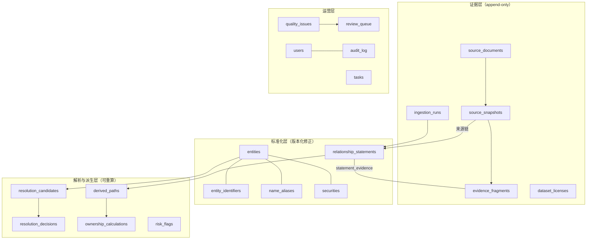

# CapitalGraph 数据模型

版本：0.3 ｜ 2026-09-12 ｜ 与 `packages/domain` 实现保持同步

## 模型总览（分层）

## 实体与标识

| 表 | 说明 | 关键列 |
| --- | --- | --- |
| entities | 企业/自然人/基金/合伙/机构/政府或国资机构/证券/分支机构 | id, kind, primary_name_id, created_at, merged_into_id(疑似重复/合并), region_code(6位行政区划，可空，索引), industry(可空，索引) |
| entity_identifiers | 外部 ID，一律带命名空间 | entity_id, namespace(uscc/lei/ticker/src:<connector>), value, valid_from/to |
| name_aliases | 名称与曾用名 | entity_id, name, norm_name, alias_type(official/former/abbreviation/translation), lang, valid_from/to |
| securities | 证券与主体关联 | entity_id, code, exchange, security_type |

约束：禁止名称作主键；`(namespace, value)` 唯一（活跃期间）；USCC 过 GB 32100 校验位。

## 声明层（时态、证据优先）

| 表 | 说明 |
| --- | --- |
| relationship_statements | subject/predicate/object 三元声明：predicate ∈ holds_shares/controls/beneficial_owner_candidate/invests_in/appointed_at/legal_rep/provides_guarantee/pledges_shares/related_transaction/same_control；含 share_ratio、voting_ratio、control_type、currency、amount、valid_from/valid_to、recorded_at、status、claim_basis、confidence |
| ownership_statements | 持股特化视图（独立表，不与控制混同）：share_ratio、share_class、via_security |
| control_statements | 控制特化：control_type(voting_rights/board/contract/de_facto/government)，表决权路径说明 |

硬约束：**持股不自动等于控制**。ownership 与 control 必须分别成声明；控制可引用持股证据但不隐式生成。

## 证据层（append-only）

| 表 | 说明 |
| --- | --- |
| source_documents | 来源登记：connector_id、原始 URL、访问时间、条款/许可证说明、内容哈希 |
| source_snapshots | 抓取快照：document_id、存储键(对象存储 sha256)、http_status、fetched_at；原文可关闭则只存哈希 |
| evidence_fragments | 证据片段：snapshot_id、json_path/xpath、字段、原始值、标准化值、页面行号 |
| dataset_licenses | 数据集许可证与允许用途 |
| ingestion_runs | 采集运行：connector、参数哈希、started/finished、status、counts、error 摘要 |

每个声明通过 `statement_evidence`(statement_id, evidence_fragment_id, actor, note) 关联 ≥1 证据片段；
无证据声明只能在 status=disputed/pending_review 下存在。

## 实体解析

| 表 | 说明 |
| --- | --- |
| resolution_candidates | 特征(JSON)、分数、阈值、匹配方法版本、输入哈希 |
| resolution_decisions | candidate → decision(merge/reject/pending)、decided_by(rule/model/human)、版本、理由 |

## 派生层（可重算）

| 表 | 说明 |
| --- | --- |
| derived_paths | 每条路径：root→…→leaf、边声明 id 列表、直接比例、路径乘积、环路标记 |
| ownership_calculations | 一次计算：root、at、config(深度/阈值)、config_hash、algorithm_version、输入声明集合哈希、聚合有效权益、方法说明、unknown 字段显式置空 |
| risk_flags | flag_type(cycle/cross_holding/missing_ratio/ratio_anomaly/low_confidence/duplicate_candidate/stale_source/**guarantee_cycle/guarantee_chain_exposure**，v0.4 扩展)、subject、payload、状态。担保类 payload 记录 input_digest（边集内容摘要）/algorithm_version/config_hash，同 (类型,主体,摘要) 的 open 标记幂等去重 |

## 数据质量与复核

| 表 | 说明 |
| --- | --- |
| quality_issues | 规则名、严重度、目标实体/声明、检测运行、状态(open/confirmed/dismissed) |
| review_queue | 待人工复核：类型(冲突/疑似重复/低置信/来源失效)、payload、assignee、结果 |

## 运营与安全

| 表 | 说明 |
| --- | --- |
| users | 用户名、口令哈希(argon2id)、角色、is_active |
| audit_log | 追加式：actor、action、target、request_id、result、at、detail(JSON，脱敏) |
| tasks | worker 任务：kind、幂等键(唯一)、payload、status、attempts、next_retry_at、last_error |

## 时态规则

- 有效性区间左闭右开：`valid_from <= at < valid_to`；`valid_to` 为空表示至今。
- 修正不覆盖：旧声明 `status→superseded` 并新开一条，`superseded_by_id` 指向新声明。
- `recorded_at` 永远不改写历史答案。

## v0.4 合成演示场景（synthetic 连接器，确定性）

担保/质押声明在持股/控制生成之后追加，使用独立 rng（seed 派生，不干扰既有生成序列，
同 seed 全量数据保持稳定）：

| 场景 | 声明 | 说明 |
| --- | --- | --- |
| 链式担保圈 | C2→C3→C4→C5 provides_guarantee（12000/9000 万元，末档缺金额） | 演示链条传导与"缺失金额显式计数" |
| 环式互保圈 | C5→C6→C7→C5 provides_guarantee（5000×2 + 一条缺金额） | 演示互保圈检测与圈上传导 |
| 股权质押 | C1 pledges_shares C2（40%，3000 万元） | 质押敞口展示（不参与链式传导） |

公司数不足时对应场景整体跳过（entities≥5 链式、≥8 环式、≥3 质押）。

## CSV 连接器 record_type 扩展（v0.4）

`record_type` 在 entity/holding/control 之外新增：

- `guarantee` → provides_guarantee（subject=担保人，object=被担保人；金额走可选 amount_wan，ratio 可空）；
- `pledge` → pledges_shares（subject=出质人，object=出质股权标的公司；可选 ratio + amount_wan）。

金额缺失合法入库（amount_scaled=NULL，绝不补值）；坏行仍按行拒绝并留痕。

## v0.5 派生视图口径（无新增表）

变更事件流、格局对比与证据覆盖率均为**派生只读视图**，直接由既有表计算（`relationship_statements`
+ `statement_evidence` + 实体维度），不新增物理表、不落库派生行：

- 事件输入行 = status=active 且 `valid_from <= at < valid_to` 的声明（全部谓词，含比例）；
  两个时点各加载一次后在应用层做集合对比（ADR-017：键 = subject+predicate+object）；
- 覆盖率输入行 = 同上时点过滤 + 连接器 + 年度 + `EXISTS(statement_evidence)` 存在性标记
  （ADR-018：覆盖率只呈现不修复，缺失样本显式列出）；
- 对比输出（族增减/流向对增减/HHI 差值）同样只读，比较两侧为各自时点的完整重算结果。

## v0.5 已知输入缺陷修复（synthetic 分批）

合成连接器原按同一索引把实体与声明切片，实体 > 400 时跨批声明主体键解析失败且证据静默丢失；
v0.5 起先产出全部实体批次再产出全部声明批次（同一事务内标识符回查可靠），并在"声明携带证据
但批次未登记来源文档"时显式上报 issue。种子数据载荷与顺序不变，既有 seed=42 断言零回归。

## v0.6 证据质量视图：趋势与时效（无新增表）

覆盖率趋势与证据时效延续"派生只读视图"路线，不新增物理表：

- **覆盖率趋势** = 覆盖率输入行（ADR-018 口径）按声明 `valid_from` 年度再分组的纯函数投影；
  `delta_vs_prev` 为应用层计算的展示字段，不落库；
- **证据时效** = `relationship_statements`（时点有效）join `statement_evidence → source_snapshots`
  后按声明取 `MAX(fetched_at)` 的聚合行；`source_snapshots.fetched_at` 语义自此为
  **证据快照取证时间**（连接器可显式传入 `EvidenceRecord.captured_at`，缺省入库时间兜底），
  该列自 v0.3 建表即存在，无 schema 变更、无迁移；旧库数据语义自然兼容（等于入库时间）；
- **时效登记**是 v0.6 唯一写路径：POST /staleness/scan 把候选写为 `quality_issues`
  （rule_name=stale_source，payload 附 at/years/age_years/cutoff），幂等键 = 同声明已有
  open 的同名 issue 则 skip——复核通道复用 v0.5 既有表，不新增表。

## v0.7 质量规则视图（无新增表）

- **有效性**输入行 = `entity_identifiers`（namespace=uscc）投影，格式校验在应用层纯函数
  完成（校验位算法复用 domain 层，存储层不判合法性）；
- **唯一性 / 跨源一致性**输入行 = 时点有效声明（与覆盖率同一过滤口径）投影出
  (statement_id, subject, predicate, object, connector_id, share_ratio_scaled)，
  分组与冲突判定在应用层纯函数完成；比例比较用缩放整数，展示层经
  `scaled_to_percent` 反解；
- 均为派生只读视图，无新增表、无写入路径；候选"登记复核"仍写 v0.5 既有
  `quality_issues` 表（本版未接写通道，规则候选仅呈现）。
